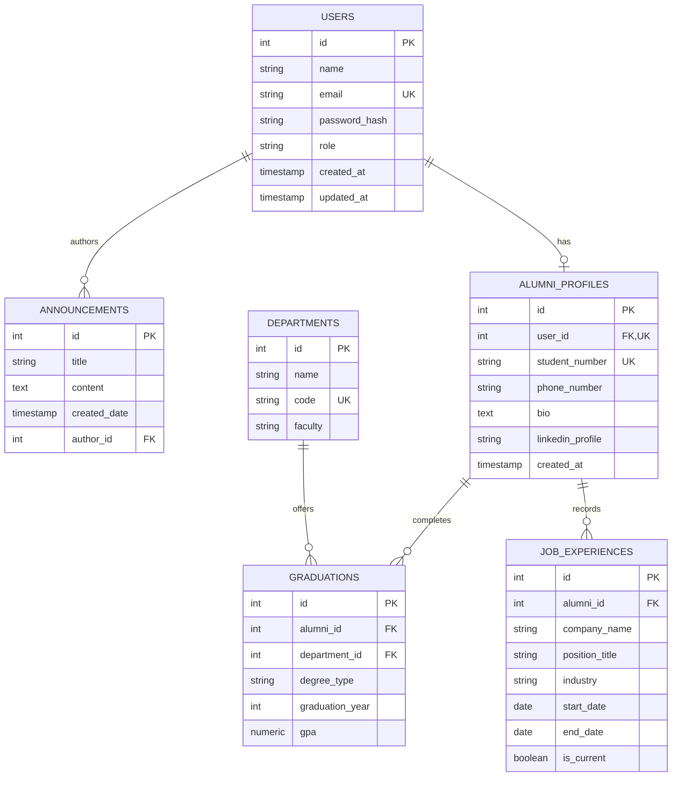

# 📊 Data Design Documentation (DDD)
**Alumni Tracking System**

---

## 1. Purpose and Scope

### 1.1 Purpose
This **Data Design Document (DDD)** details the data architecture, entity models, storage strategies, and persistence mechanisms of the **Alumni Tracking System**. The primary objective is to document both the **currently implemented in-memory data structures** verified directly in the codebase and the **proposed relational database architecture** scheduled for subsequent development phases.

### 1.2 Scope
* **Current Scope (Active Codebase):**
  * POCO entity models (`User` and `Announcement`).
  * In-memory static storage collections (`UserStore` and `AnnouncementStore`).
  * Interaction between web presentation controllers (`UserController`, `AnnouncementController`, `AnnouncementAdminController`), REST API controllers (`ApiUserController`), and in-memory data stores.
  * Comprehensive analysis of current storage limitations, concurrency risks, and non-persistence behavior.
* **Future Scope (Proposed Architecture - Not Implemented):**
  * Relational database integration using **PostgreSQL 17** (containerized via [docker-compose.yml](docker-compose.yml)).
  * Object-Relational Mapping (ORM) schema design via **Entity Framework Core 9.0**.
  * Domain expansion including `AlumniProfile`, `Department`, `GraduationRecord`, and `JobExperience` entities.
  * Formal relational foreign key relationships, database constraints, indexing strategies, and migration roadmap.

> [!NOTE]
> **Status Notice:** At the current development milestone, **no database connection or active EF Core DbContext is running**. Furthermore, neither Entity Framework Core nor Npgsql packages are installed in the project. Data is managed strictly in process memory. Planned database features documented in [Section 7](#7-planned-database-design-proposed-future-architecture---not-implemented) reflect the target architectural blueprint and are explicitly marked as proposed and not implemented.

---

## 2. Current Data Model

The data layer of the Alumni Tracking System currently operates on a lightweight, decoupled **In-Memory POCO (Plain Old CLR Object) model**.

### 2.1 Architectural Flow
```text
  +---------------------------------------------------------------------------------+
  |                             Presentation & API Layer                            |
  |                                                                                 |
  |  +--------------------+  +-------------------------+  +----------------------+  |
  |  |  UserController    |  |  AnnouncementController |  | AnnouncementAdmin    |  |
  |  |  (MVC - /User)     |  |  (MVC - /Announcement)  |  | Controller (/Admin)  |  |
  |  +---------+----------+  +------------+------------+  +----------+-----------+  |
  |            |                          |                          |              |
  |            |     +--------------------+                          |              |
  |            |     |  ApiUserController |                          |              |
  |            |     |  (REST - /api/users)                          |              |
  |            |     +---------+----------+                          |              |
  +------------|---------------|-------------------------------------|--------------+
               |               |                                     |
               v               v                                     v
  +---------------------------------------------------------------------------------+
  |                          Data Store Layer (In-Memory)                           |
  |                                                                                 |
  |     +----------------------------------+   +-------------------------------+    |
  |     |            UserStore             |   |       AnnouncementStore       |    |
  |     |   public static List<User>       |   | public static List<Announcement>|  |
  |     |   (Initialized Empty: new())     |   | (Pre-seeded with 3 items)     |    |
  |     +----------------+-----------------+   +---------------+---------------+    |
  +----------------------|-------------------------------------|--------------------+
                         v                                     v
  +---------------------------------------------------------------------------------+
  |                                Business Entities                                |
  |                                                                                 |
  |           +----------------------+             +-------------------------+      |
  |           |     User Entity      |             |   Announcement Entity   |      |
  |           |----------------------|             |-------------------------|      |
  |           | int Id               |             | int Id                  |      |
  |           | string Name          |             | string Title            |      |
  |           | string Email         |             | string Content          |      |
  |           +----------------------+             | DateTime CreatedDate    |      |
  |                                                +-------------------------+      |
  +---------------------------------------------------------------------------------+
```

### 2.2 Key Characteristics of the Current Model
1. **POCO-Based:** Entities contain only auto-implemented properties without database annotations, ORM mapping attributes, or external persistence logic.
2. **Static In-Memory Stores:** Data collections reside in RAM within static classes (`UserStore` and `AnnouncementStore`) scoped to the web application process (`AppDomain`).
3. **No Active DbContext or ORM Packages:** The application pipeline in [Program.cs](Program.cs) configures MVC controllers, Swagger/OpenAPI, and static files, but does **not** register any `DbContext`, connection string, or relational database provider. The project file [Alumni.csproj](Alumni.csproj) contains only `Microsoft.AspNetCore.OpenApi` and `Swashbuckle.AspNetCore`; no EF Core or PostgreSQL NuGet packages are currently installed.
4. **Seed State:**
   * `UserStore.Users`: Starts completely empty (`Count = 0`).
   * `AnnouncementStore.Announcements`: Pre-populated with 3 initial static announcements representing upcoming events and news.

---

## 3. Entities and Attributes

The current codebase defines two concrete business entities located in the `Alumni.Models` namespace: **User** and **Announcement**.

### 3.1 User Entity (`Alumni.Models.User`)

The `User` entity represents system users (graduates, administrators, and visitors) registered in the platform.

* **Source File:** [Models/User.cs](Models/User.cs)
* **Namespace:** `Alumni.Models`
* **C# Implementation:**
  ```csharp
  namespace Alumni.Models;

  public class User
  {
      public int Id { get; set; }
      public string Name { get; set; } = string.Empty;
      public string Email { get; set; } = string.Empty;
  }
  ```

#### Attribute Specification
| Attribute Name | C# Type | Default Value | Nullable | Validation Rules (in Controllers) | Description |
| -------------- | ------- | ------------- | -------- | --------------------------------- | ----------- |
| `Id` | `int` | `0` | No | Auto-assigned in controllers (`Max(u => u.Id) + 1` or `1`) | Unique identifier for the user record. |
| `Name` | `string` | `string.Empty` | No | `!string.IsNullOrWhiteSpace(user.Name)` | Full name of the user. Form/API input required. |
| `Email` | `string` | `string.Empty` | No | `!string.IsNullOrWhiteSpace(user.Email)` | Email address of the user. Form/API input required. |

#### Usage Context & Controllers
* **MVC Controller ([Controllers/UserController.cs](Controllers/UserController.cs)):**
  * `GET /User` (or `/User/Index` and `/users`): Displays all users in a tabular view.
  * `GET /User/Details/{id}`: Displays single user profile details.
  * `GET /User/Create` & `POST /User/Create`: Validates inputs and appends the user to `UserStore.Users`.
  * `GET /User/Edit/{id}` & `POST /User/Edit/{id}`: Updates existing user properties in-place.
  * `GET /User/Delete/{id}` & `POST /User/Delete/{id}`: Removes the user from `UserStore.Users`.
* **REST API Controller ([Controllers/ApiUserController.cs](Controllers/ApiUserController.cs)):**
  * `GET /api/users`: Returns JSON array of users (`200 OK`).
  * `GET /api/users/{id}`: Returns single user JSON (`200 OK` or `404 Not Found`).
  * `POST /api/users`: Accepts JSON body, auto-assigns next ID, and returns `201 Created`.
  * `PUT /api/users/{id}`: Replaces `Name` and `Email` (`200 OK` or `404 Not Found`).
  * `PATCH /api/users/{id}`: Partially updates non-empty `Name` or `Email` (`200 OK`).
  * `DELETE /api/users/{id}`: Deletes user by ID (`204 NoContent` or `404 Not Found`).

---

### 3.2 Announcement Entity (`Alumni.Models.Announcement`)

The `Announcement` entity represents public news, event invitations, and general broadcast notifications posted for the alumni community.

* **Source File:** [Models/Announcement.cs](Models/Announcement.cs)
* **Namespace:** `Alumni.Models`
* **C# Implementation:**
  ```csharp
  namespace Alumni.Models;

  public class Announcement
  {
      public int Id { get; set; }
      public string Title { get; set; } = string.Empty;
      public string Content { get; set; } = string.Empty;
      public DateTime CreatedDate { get; set; } = DateTime.Now;
  }
  ```

#### Attribute Specification
| Attribute Name | C# Type | Default Value | Nullable | Validation Rules (in Controllers) | Description |
| -------------- | ------- | ------------- | -------- | --------------------------------- | ----------- |
| `Id` | `int` | `0` | No | Auto-assigned in admin controller (`Max(a => a.Id) + 1` or `1`) | Unique identifier for the announcement. |
| `Title` | `string` | `string.Empty` | No | `!string.IsNullOrWhiteSpace(announcement.Title)` | Headline / title of the announcement. Required. |
| `Content` | `string` | `string.Empty` | No | `!string.IsNullOrWhiteSpace(announcement.Content)` | Detailed description or body text. Required. |
| `CreatedDate` | `DateTime` | `DateTime.Now` | No | Reset to `DateTime.Now` on creation | Timestamp indicating when the announcement was published. |

#### Pre-Seeded Data in Store ([Models/AnnouncementStore.cs](Models/AnnouncementStore.cs))
Unlike `UserStore`, `AnnouncementStore` is initialized at application startup with three mock announcements:
1. **Id:** `1` | **Title:** *"Annual Alumni Homecoming 2026"* | **CreatedDate:** 7 days ago.
2. **Id:** `2` | **Title:** *"Alumni Mentorship Program Launched"* | **CreatedDate:** 3 days ago.
3. **Id:** `3` | **Title:** *"Campus Tech & Innovation Hub Grand Opening"* | **CreatedDate:** 1 day ago.

#### Usage Context & Controllers
* **Public MVC Controller ([Controllers/AnnouncementController.cs](Controllers/AnnouncementController.cs)):**
  * `GET /Announcement`: Retrieves announcements sorted by `CreatedDate` descending and renders them into cards for public visitors.
  * `GET /Announcement/Details/{id}`: Displays single announcement body text and metadata.
* **Administrative MVC Controller ([Controllers/AnnouncementAdminController.cs](Controllers/AnnouncementAdminController.cs)):**
  * `GET /AnnouncementAdmin`: Renders administrative management table listing all announcements with management action buttons.
  * `GET /AnnouncementAdmin/Create` & `POST /AnnouncementAdmin/Create`: Validates non-empty fields, stamps `CreatedDate = DateTime.Now`, auto-calculates ID, and appends to `AnnouncementStore.Announcements`.
  * `GET /AnnouncementAdmin/Edit/{id}` & `POST /AnnouncementAdmin/Edit/{id}`: Edits existing `Title` and `Content` in-place.
  * `GET /AnnouncementAdmin/Delete/{id}` & `POST /AnnouncementAdmin/Delete/{id}`: Confirms and deletes announcement from store.

---

## 4. Relationships Between Entities

### 4.1 Current Reality in Code
In the current implementation:
* **There are NO direct relationships between `User` and `Announcement`.**
* Neither entity contains a foreign key, reference identifier, or navigation property linking to the other:
  * `User` has no `Announcements` collection or reference.
  * `Announcement` has no `UserId`, `AuthorId`, `CreatedBy`, or `User` navigation property.
* `UserStore.Users` and `AnnouncementStore.Announcements` operate as two completely isolated, independent static lists in application memory.

### 4.2 Why Are They Currently Decoupled?
1. **Iterative Course Architecture:** Early assignments focused on establishing distinct MVC and Web API mechanics (e.g., dual MVC/API endpoints for Users, and dual Public/Admin views for Announcements) before introducing relational foreign keys.
2. **No Relational Engine Yet:** In-memory collections lack relational integrity constraints (such as foreign key cascades or foreign key validations). Maintaining foreign keys manually in memory without an ORM adds fragility without persistent benefits.

### 4.3 Proposed Relationships (Future Architecture - Not Implemented)

> [!NOTE]
> **Proposed Conceptual Design:** The following relationships represent the target design for future database phases. **None of these relationships, foreign keys, or navigation properties exist in the current codebase.**

1. **`User` (1) — to — (N) `Announcement` (Proposed):**
   * An `author_id` foreign key column is planned for the `announcements` table referencing `users(id)`.
   * This will capture which administrative user authored or published each announcement.
2. **`User` (1) — to — (1) `AlumniProfile` (Proposed):**
   * A user with an "Alumni" role will have an associated detailed alumni profile.
3. **`Department` (1) — to — (N) `GraduationRecord` (Proposed):**
   * Departments will have many associated alumni graduation records.
4. **`AlumniProfile` (1) — to — (N) `GraduationRecord` (Proposed):**
   * An alumnus can hold multiple degrees (e.g., Undergraduate, Master's, PhD).
5. **`AlumniProfile` (1) — to — (N) `JobExperience` (Proposed):**
   * An alumnus can record multiple sequential or concurrent professional career positions.

---

## 5. Current Data Storage Strategy

### 5.1 Storage Architecture
The application currently employs a **Static In-Memory Store pattern** using the standard C# collection `System.Collections.Generic.List<T>`.

* **UserStore Implementation ([Models/UserStore.cs](Models/UserStore.cs)):**
  ```csharp
  namespace Alumni.Models;

  public static class UserStore
  {
      public static List<User> Users { get; } = new();
  }
  ```
* **AnnouncementStore Implementation ([Models/AnnouncementStore.cs](Models/AnnouncementStore.cs)):**
  ```csharp
  namespace Alumni.Models;

  public static class AnnouncementStore
  {
      public static List<Announcement> Announcements { get; } = new()
      {
          new Announcement { Id = 1, Title = "...", Content = "...", CreatedDate = DateTime.Now.AddDays(-7) },
          new Announcement { Id = 2, Title = "...", Content = "...", CreatedDate = DateTime.Now.AddDays(-3) },
          new Announcement { Id = 3, Title = "...", Content = "...", CreatedDate = DateTime.Now.AddDays(-1) }
      };
  }
  ```

### 5.2 CRUD Mechanics in Memory
Because data is held in standard generic lists, all operations execute directly in the web server's memory heap using LINQ:

| Operation | C# / LINQ Implementation in Controllers | Complexity |
| --------- | --------------------------------------- | ---------- |
| **Create (User)** | `user.Id = UserStore.Users.Count > 0 ? UserStore.Users.Max(u => u.Id) + 1 : 1;`<br>`UserStore.Users.Add(user);` | $O(N)$ for Max ID, $O(1)$ amortized for Add |
| **Create (Announcement)** | `announcement.Id = AnnouncementStore.Announcements.Count > 0 ? AnnouncementStore.Announcements.Max(a => a.Id) + 1 : 1;`<br>`announcement.CreatedDate = DateTime.Now;`<br>`AnnouncementStore.Announcements.Add(announcement);` | $O(N)$ for Max ID, $O(1)$ amortized for Add |
| **Read (All)** | `UserStore.Users`<br>`AnnouncementStore.Announcements.OrderByDescending(a => a.CreatedDate).ToList()` | $O(1)$ for raw list; $O(N \log N)$ for sorting |
| **Read (Single by ID)** | `UserStore.Users.FirstOrDefault(u => u.Id == id)`<br>`AnnouncementStore.Announcements.FirstOrDefault(a => a.Id == id)` | $O(N)$ linear search |
| **Update** | `var existing = UserStore.Users.FirstOrDefault(u => u.Id == id);`<br>`existing.Name = updated.Name;`<br>`existing.Email = updated.Email;` | $O(N)$ search + $O(1)$ in-place object reference mutation |
| **Delete** | `var item = UserStore.Users.FirstOrDefault(u => u.Id == id);`<br>`UserStore.Users.Remove(item);` | $O(N)$ search + $O(N)$ array shift on removal |

### 5.3 Shared State Between MVC and API
A notable feature of this design is that `UserStore.Users` is **shared simultaneously** by both:
* `UserController` (rendering HTML views for browser users)
* `ApiUserController` (handling JSON payloads from external HTTP clients)

Creating, modifying, or deleting a user via the REST API (`/api/users`) is immediately visible in the MVC web interface (`/User`), and vice-versa, because both controllers reference the same static collection instance in memory.

---

## 6. Data Persistence and Limitations

While the in-memory static storage pattern enables rapid prototyping without external database setup, it introduces critical technical limitations that prevent production usage.

### 6.1 Critical Limitations

#### 1. Zero Persistence (Data Volatility)
* **Lifecycle Boundary:** The data lives solely inside RAM allocated to the running ASP.NET Core process.
* **Data Loss on Restart:** Any application restart (recompilation, `dotnet run` stop, server reboot, crash, or IIS/Kestrel worker recycling) immediately clears all runtime changes.
* **Consequence:** Newly added users disappear, modified announcements revert to their original values, and deleted seed announcements re-appear on startup.

#### 2. Thread Safety and Concurrency Hazards
* **Non-Thread-Safe Collection:** `System.Collections.Generic.List<T>` is **not thread-safe** for multi-threaded write operations.
* **Concurrent HTTP Requests:** ASP.NET Core processes simultaneous HTTP requests on separate thread-pool threads.
* **Potential Faults:**
  * If two users submit `POST /api/users` or `POST /AnnouncementAdmin/Create` at the exact same millisecond, race conditions in `.Max(x => x.Id)` can produce duplicate IDs.
  * Simultaneous write operations while another thread executes `Index()` (which enumerates the list) can trigger `System.InvalidOperationException: Collection was modified; enumeration operation may not execute.`
  * In extreme scenarios, concurrent mutations can corrupt list internal pointers.

#### 3. Lack of ACID Guarantees
* **No Atomicity:** Multi-step transactions do not exist. If an error occurs halfway through an update, partial mutations cannot be rolled back.
* **No Consistency:** No foreign key validation, schema type enforcement, or unique constraint checks (e.g., duplicate email addresses are currently permitted by the store).
* **No Isolation:** Dirty reads and uncommitted state mutations are instantly visible across all threads.
* **No Durability:** Changes are not written to a Write-Ahead Log (WAL) or durable disk storage.

#### 4. Scalability & Horizontal Distribution Impossibility
* **Single-Process Bound:** The static store cannot be shared across multiple instances or load-balanced containers.
* **Inconsistent State:** In a clustered or containerized setup, a user created on Instance 1 would be completely invisible to users served by Instance 2.

#### 5. Memory Consumption & Search Performance
* **Unbounded Memory Growth:** Every new record increases application heap memory usage. Without database paging or disk offloading, high record volumes degrade garbage collector (GC) performance.
* **Linear $O(N)$ Scans:** Lookups by ID or email require sequential evaluation of every item in the list, lacking B-tree or hash-based database indexing.

---

## 7. Planned Database Design (Proposed Future Architecture - Not Implemented)

> [!IMPORTANT]
> **Proposed Future Architecture — Not Yet Implemented:**
> The PostgreSQL tables, entity-relationship (ER) diagram, schema definitions, and EF Core mappings detailed in this section represent a **proposed design** for future iterations. **None of these database tables, foreign keys, constraints, or EF Core DbContext configurations exist or run in the current application.** At present, the application operates solely using in-memory generic lists (`UserStore` and `AnnouncementStore`).

### 7.1 Target Infrastructure & Technology Stack (Planned)
* **Target RDBMS Engine:** **PostgreSQL 17** (Alpine Linux distribution).
* **Development Container Configuration ([docker-compose.yml](docker-compose.yml)):**
  * **Service Name:** `db`
  * **Container Name:** `alumni-postgres`
  * **Image:** `postgres:17-alpine`
  * **Database Name:** `alumni_db`
  * **Database User:** `alumni_user`
  * **Default Port:** `5432`
  * **Persistent Volume:** `alumni_postgres_data`
  * **Healthcheck:** `pg_isready -U alumni_user -d alumni_db`
  *(Note: The docker-compose configuration defines the database environment, but the C# application does not yet connect to it).*
* **Data Access Framework (Planned):** **Entity Framework Core 9.0** with `Npgsql.EntityFrameworkCore.PostgreSQL` provider.
  *(Note: Neither EF Core nor Npgsql packages are currently installed in the project. The active project file [Alumni.csproj](Alumni.csproj) currently references only `Microsoft.AspNetCore.OpenApi` and `Swashbuckle.AspNetCore`. These ORM packages are planned to be added during the future database integration phase).*

---

### 7.2 Proposed Entity-Relationship (ER) Diagram (Future Target - Not Implemented)

> The diagram below represents the proposed relational schema planned for upcoming phases. It is **not implemented** in the current codebase.



---

### 7.3 Proposed Relational Database Schema — PostgreSQL Tables (Future Target - Not Implemented)

> The following SQL DDL statements illustrate the proposed table designs for PostgreSQL. **No database migrations or SQL tables exist yet in the running application.**

#### 1. `users` Table (Proposed)
Stores basic credentials, authentication identities, and contact information.

```sql
CREATE TABLE users (
    id INT GENERATED ALWAYS AS IDENTITY PRIMARY KEY,
    name VARCHAR(150) NOT NULL,
    email VARCHAR(255) NOT NULL UNIQUE,
    password_hash VARCHAR(255) NULL,
    role VARCHAR(50) NOT NULL DEFAULT 'User',
    created_at TIMESTAMPTZ NOT NULL DEFAULT CURRENT_TIMESTAMP,
    updated_at TIMESTAMPTZ NULL
);

CREATE INDEX idx_users_email ON users(email);
```

#### 2. `announcements` Table (Proposed)
Stores published public notices, news, and reunion announcements with author attribution.

```sql
CREATE TABLE announcements (
    id INT GENERATED ALWAYS AS IDENTITY PRIMARY KEY,
    title VARCHAR(200) NOT NULL,
    content TEXT NOT NULL,
    created_date TIMESTAMPTZ NOT NULL DEFAULT CURRENT_TIMESTAMP,
    author_id INT NULL,
    CONSTRAINT fk_announcements_author
        FOREIGN KEY (author_id)
        REFERENCES users(id)
        ON DELETE SET NULL
);

CREATE INDEX idx_announcements_created_date ON announcements(created_date DESC);
CREATE INDEX idx_announcements_author ON announcements(author_id);
```

#### 3. `departments` Table (Proposed)
Stores university faculties and academic departments offering degree programs.

```sql
CREATE TABLE departments (
    id INT GENERATED ALWAYS AS IDENTITY PRIMARY KEY,
    name VARCHAR(150) NOT NULL,
    code VARCHAR(20) NOT NULL UNIQUE,
    faculty VARCHAR(150) NOT NULL
);

CREATE INDEX idx_departments_code ON departments(code);
```

#### 4. `alumni_profiles` Table (Proposed)
Stores alumni-specific academic records, profiles, and professional links.

```sql
CREATE TABLE alumni_profiles (
    id INT GENERATED ALWAYS AS IDENTITY PRIMARY KEY,
    user_id INT NOT NULL UNIQUE,
    student_number VARCHAR(30) NOT NULL UNIQUE,
    phone_number VARCHAR(30) NULL,
    bio TEXT NULL,
    linkedin_profile VARCHAR(255) NULL,
    created_at TIMESTAMPTZ NOT NULL DEFAULT CURRENT_TIMESTAMP,
    CONSTRAINT fk_alumni_profiles_user
        FOREIGN KEY (user_id)
        REFERENCES users(id)
        ON DELETE CASCADE
);

CREATE INDEX idx_alumni_student_number ON alumni_profiles(student_number);
```

#### 5. `graduations` Table (Proposed)
Associates an alumnus with a department, degree type, and graduation year.

```sql
CREATE TABLE graduations (
    id INT GENERATED ALWAYS AS IDENTITY PRIMARY KEY,
    alumni_id INT NOT NULL,
    department_id INT NOT NULL,
    degree_type VARCHAR(50) NOT NULL,
    graduation_year INT NOT NULL,
    gpa NUMERIC(3,2) NULL,
    CONSTRAINT fk_graduations_alumni
        FOREIGN KEY (alumni_id)
        REFERENCES alumni_profiles(id)
        ON DELETE CASCADE,
    CONSTRAINT fk_graduations_department
        FOREIGN KEY (department_id)
        REFERENCES departments(id)
        ON DELETE RESTRICT
);

CREATE INDEX idx_graduations_alumni ON graduations(alumni_id);
CREATE INDEX idx_graduations_year ON graduations(graduation_year);
```

#### 6. `job_experiences` Table (Proposed)
Stores career history, company associations, and current employment statuses for alumni.

```sql
CREATE TABLE job_experiences (
    id INT GENERATED ALWAYS AS IDENTITY PRIMARY KEY,
    alumni_id INT NOT NULL,
    company_name VARCHAR(150) NOT NULL,
    position_title VARCHAR(150) NOT NULL,
    industry VARCHAR(100) NULL,
    start_date DATE NOT NULL,
    end_date DATE NULL,
    is_current BOOLEAN NOT NULL DEFAULT FALSE,
    CONSTRAINT fk_job_experiences_alumni
        FOREIGN KEY (alumni_id)
        REFERENCES alumni_profiles(id)
        ON DELETE CASCADE
);

CREATE INDEX idx_job_experiences_alumni ON job_experiences(alumni_id);
```

---

### 7.4 Migration & Implementation Strategy (Future Roadmap)

To transition safely from in-memory stores to PostgreSQL and EF Core in future phases without breaking existing controller contracts, the following staged migration plan is established:

```text
  Phase 1: Database Provisioning
  +--------------------------------------------------------------+
  |  Launch PostgreSQL 17 container using docker compose up -d   |
  |  Configure connection string in appsettings.Development.json |
  +------------------------------+-------------------------------+
                                 |
  Phase 2: EF Core Packages & Data Layer Definition
  +------------------------------v-------------------------------+
  |  Add Npgsql.EntityFrameworkCore.PostgreSQL package to csproj |
  |  Create AlumniDbContext class deriving from DbContext        |
  |  Define DbSet<User> and DbSet<Announcement>                  |
  |  Configure entity relationships and constraints via Fluent API|
  +------------------------------+-------------------------------+
                                 |
  Phase 3: Database Migrations
  +------------------------------v-------------------------------+
  |  Generate initial migration: dotnet ef migrations add Initial |
  |  Apply migration to PostgreSQL: dotnet ef database update    |
  +------------------------------+-------------------------------+
                                 |
  Phase 4: Data Seeding
  +------------------------------v-------------------------------+
  |  Migrate the 3 seed announcements from AnnouncementStore.cs  |
  |  into DbContext.OnModelCreating HasData(...) seeding         |
  +------------------------------+-------------------------------+
                                 |
  Phase 5: Controller & DI Refactoring
  +------------------------------v-------------------------------+
  |  Register AddDbContext<AlumniDbContext> in Program.cs        |
  |  Inject AlumniDbContext or Repository into Controllers       |
  |  Replace UserStore / AnnouncementStore calls with async EF   |
  |  Core methods (ToListAsync, AddAsync, SaveChangesAsync)       |
  +--------------------------------------------------------------+
```

---

## 8. Summary Comparison: Current vs. Planned Architecture

| Architectural Dimension | Current Implementation (Active) | Planned Architecture (Proposed Future Target) |
| ----------------------- | -------------------------------- | --------------------------------------------- |
| **Storage Engine** | Process Heap Memory (`List<T>`) | **PostgreSQL 17** Relational Database |
| **ORM / Data Access** | LINQ to Objects on static stores (no EF Core / Npgsql packages installed) | **Entity Framework Core 9.0** (`Npgsql.EntityFrameworkCore.PostgreSQL`) |
| **Entities Implemented** | `User`, `Announcement` | `User`, `Announcement`, `Department`, `AlumniProfile`, `Graduation`, `JobExperience` |
| **Relationships** | None (Fully decoupled, no foreign keys) | $1:N$ (`User` $\to$ `Announcement`), $1:1$ (`User` $\to$ `AlumniProfile`), $1:N$ (`Department` $\to$ `Graduation`), $1:N$ (`AlumniProfile` $\to$ `JobExperience`) |
| **Data Persistence** | Non-persistent (resets on restart) | **ACID-Compliant Persistent Storage** on disk via Docker volume |
| **Concurrency Safety** | Not thread-safe (`List<T>`) | Thread-safe transactions, connection pooling, and optimistic/pessimistic locking |
| **Integrity Enforcement**| Basic controller string checks | Foreign keys, unique indexes, database constraints, cascade rules |
| **Containerization** | Host process execution | **Docker & Docker Compose** multi-container setup |
| **Query Performance** | $O(N)$ linear scans | Indexed B-Tree lookups, relational joins, server-side pagination |
